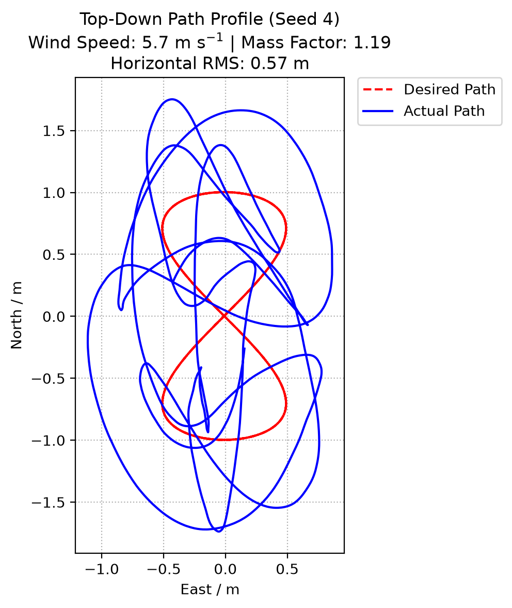
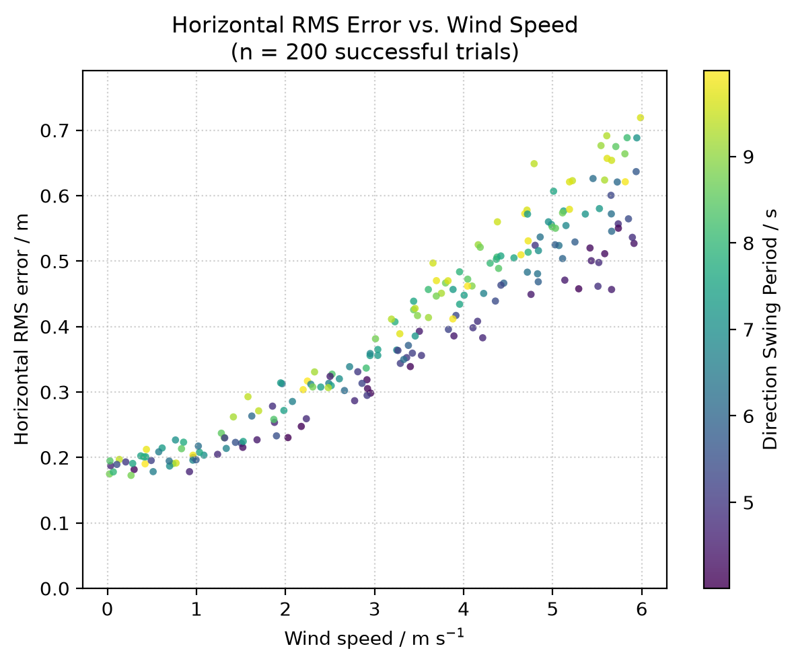
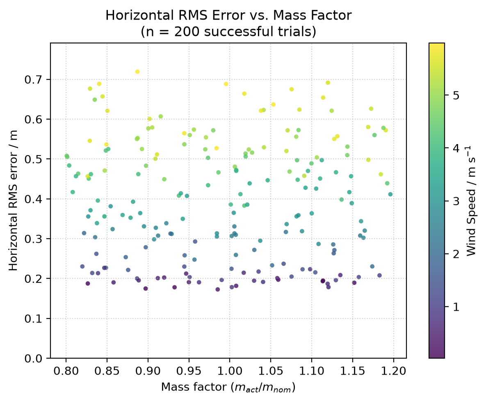

# Flightstack

A PX4 software-in-the-loop (SITL) Monte-Carlo study of how well PX4's stock cascade controller tracks a figure-8 (Lemniscate of Gerono) trajectory under gusty wind and airframe mass/inertia mismatch.

Multirotor drones hold position by continuously adjusting rotor speeds, and that control authority gets tested in gusty wind: the controller works harder, batteries drain faster, and smaller, lighter airframes feel it most. PX4's stock controller contains a fixed cascaded position/velocity/attitude/rate tuning, so before building on top of it or replacing it, it's worth knowing how that baseline actually degrades. This project separates wind disturbance from model mismatch by randomizing both independently across 200 simulated flights, then uses bootstrap resampling to pull out each one's contribution to horizontal tracking error.

## Report

A full technical write-up, covering the simulation setup, experimental design, bootstrap methodology, results analysis, limitations, and further expansions, is available ([here](https://drive.google.com/file/d/1oCsIO3NwqB7ZES63vzU85lLCyrYqC2Sn/view?usp=sharing)).

## Features

- **SITL Monte-Carlo trials**: 200 independently-seeded flights, each exactly reproducible from its seed via NumPy's `default_rng`
- **Warped-time figure-8 tracking**: a Lemniscate of Gerono flown via PX4 offboard position + velocity setpoints at 50 Hz, eased in through a smoothstep ramp so the drone starts from its hover state instead of a velocity step
- **Gusty wind injection**: Gazebo's WindEffects plugin driven by a sinusoidal magnitude surge and direction swing plus Gaussian noise, written into a fresh world SDF per trial and switched on only after a calm takeoff
- **Model mismatch**: body mass and inertia scaled ±20% per trial in a modified Gazebo model, independent of PX4's fixed internal tuning
- **Bootstrap statistics**: 10,000-resample bootstrap confidence intervals for mean RMS per wind-speed bin and for the wind/mass/swing-period regression slopes
- **Resumable batch runner**: failed trials (timeout, crash, lost connection) are recorded rather than dropped, and seeds already present in `summary.csv` are skipped on rerun

## Repository Structure

| Folder | Contents |
|---|---|
| `flight/` | Connecting/arming, telemetry streaming, the figure-8 trajectory and warped-time ramp, and the flight-tracking loop (`flight_figure8.py`) |
| `sim/` | Gazebo model/world file writers (mass, inertia, wind, gusts), PX4 + Gazebo launch/shutdown, and the per-trial runner (`sim_trial.py`) |
| `configs/` | Randomized-parameter draw ranges (`config_params.py`) and result/log paths (`config_paths.py`) |
| `scripts/` | Entry points: `run_single.py` (one visible flight), `run_batch.py` (the 200-seed Monte Carlo run), `run_noise_floor.py` (repeat-seed noise floor) |
| `analysis/` | RMS/error metrics, bootstrap resampling, and the three report figures |
| `tests/` | Unit tests for state, trajectory, warp, model, world and params (`pytest`) |
| `z_results/` | Per-trial trajectory logs, `summary.csv`, `bootstrap.csv`, and the saved figures |
| `_docs/` | Full project report (PDF) |

## Getting Started

```bash
pip install -e ".[dev]"
```

This project also needs a PX4 + Gazebo SITL stack, which isn't pip-installable:

| Setting | Value |
|---|---|
| Host OS | Windows 11, running Ubuntu 24.04 on WSL2 |
| PX4 Autopilot | v1.18.0-beta1 (development build) |
| Gazebo | Gazebo Sim 8.15.0 (Harmonic) |
| Vehicle | x500 quadrotor (PX4 airframe 4001) |
| MAVSDK-Python | `mavsdk<4` |

See [PX4's own docs](https://px4.io) for installing PX4 SITL with Gazebo.

Once that's running:

```bash
python scripts/run_single.py        # one visible flight at fixed parameters
python scripts/run_batch.py         # the full 200-seed Monte Carlo run (resumable)
python scripts/run_noise_floor.py   # repeat one seed to measure run-to-run noise
python -m analysis.analysis_figures # regenerate the report figures from summary.csv
pytest                              # run the unit tests
```

Experiment ranges and constants (figure-8 size/speed, wind speed/direction ranges, mass/inertia factors, gust timing) are set in `configs/config_params.py`.

## Results

All 200 trials (seeds 3–202) completed, with none dropped to timeout, crash, or lost connection.

**Example trajectory tracking path (seed 4, `single` run):** at a wind speed of 5.7 m s⁻¹ and a mass factor of 1.19, the actual path visibly overshoots the commanded figure-8, giving a horizontal RMS of 57 cm. THis is within about two standard deviations of the 58.6 ± 0.73 cm noise floor measured by repeating this same seed 5 times.



**Horizontal RMS error vs. wind speed (all 200 trials):** error grows with wind speed (Pearson *r* = 0.955), from a mean of 19.6 cm in the calmest [0, 1) m s⁻¹ bin to 57.9 cm in the windiest [5, 6] m s⁻¹ bin. with a bootstrap slope of 8.0 cm per additional 1.0 m s⁻¹ (95% CI [7.6, 8.4]). The color axis shows a secondary effect. After removing the wind trend, residual error correlates with the gust direction-swing period (*r* = 0.67, bootstrap effect 1.6 cm per additional second, 95% CI [1.3, 1.9]).



**Horizontal RMS error vs. mass factor (all 200 trials):** no slope is visible across the tested [0.80, 1.20] mass-factor range (*r* ≈ −0.005); the bootstrap mass effect is 0.0 cm per +10% mass change (95% CI [−0.6, 0.6]), an interval comparable to the noise floor itself. PX4's position controller adapts its throttle-to-thrust mapping to the vehicle's actual weight, so mass mismatch is absorbed with no measurable tracking degradation. This is unlike the wind setting, where the position loop must counteract through feedback alone.



## Status & Next Steps

The core question is answered: PX4's stock controller tracks the figure-8 well in calm-to-moderate wind, degrades roughly linearly with wind speed (reaching individual trials as high as 72 cm RMS by [5, 6] m s⁻¹), and is insensitive to the ±20% mass/inertia mismatch tested. Possible extensions:

- A wind-feedforward term in the position controller, using PX4's wind estimator
- A continuous-spectrum turbulence model (e.g. Dryden or von Kármán, both supported by Gazebo) in place of the sinusoidal gust approximation
- A noise floor measured at several wind speeds, rather than from one seed alone
- Other vehicles, vehicle sizes, trajectory shapes, and speeds
- Hardware-in-the-loop or real outdoor validation, to quantify sim-to-real differences in wind slope and noise floor

AI assistance used while building this project is logged step-by-step in [`AI_USE.md`](AI_USE.md).

## References

1. PX4 Autopilot, v1.18.0-beta1 (development build). https://px4.io / https://github.com/PX4/PX4-Autopilot
2. Gazebo Sim, version 8.15.0. Open Source Robotics Foundation. https://gazebosim.org
3. MAVSDK-Python (`mavsdk<4`). https://github.com/mavlink/MAVSDK-Python
4. Harris, C. R., Millman, K. J., van der Walt, S. J., et al. (2020). Array programming with NumPy. *Nature*, 585, 357–362.
5. McKinney, W. (2010). Data Structures for Statistical Computing in Python. *Proceedings of the 9th Python in Science Conference*, 56–61.
6. Hunter, J. D. (2007). Matplotlib: A 2D graphics environment. *Computing in Science & Engineering*, 9(3), 90–95.
7. Efron, B., & Tibshirani, R. J. (1993). *An Introduction to the Bootstrap*. Chapman & Hall/CRC.
